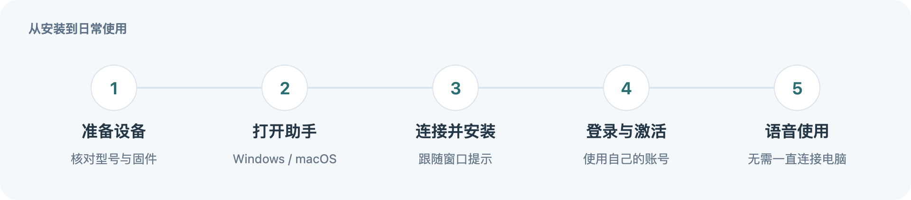
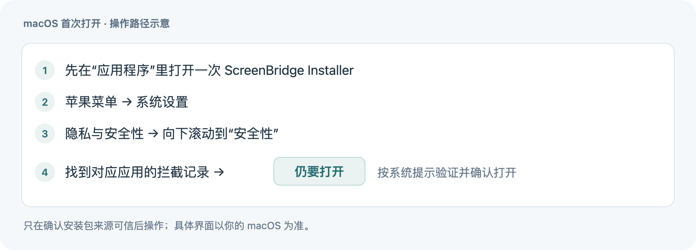

# 安装与使用手册

让小度多一个语音入口，用熟悉的“小度小度”打开豆包。

小度豆包屏桥是一个持续适配中的个人项目。安装后，可以用语音打开豆包通话，结束时回到小度桌面；完成安装与激活后，日常使用不需要一直连接电脑。

目前提供 **Windows 和 macOS 安装助手**。这份手册从打开安装包开始，带你完成连接、安装、登录与激活，无需输入命令，也不用另外安装编程工具。

> 前 **50 名**参与试用体验的朋友，可以直接联系开发者获取激活码。欢迎分享使用感受，也欢迎其他型号的机主一起参与适配。微信：**nevernamed**。

**按顺序阅读：** [准备](#1-开始前先确认) → [Windows / Mac 安装](#2-打开电脑上的安装助手) → [连接小度](#3-连接小度并安装) → [登录](#4-在小度上登录豆包) → [激活](#5-领取激活码) → [使用](#6-开始日常使用)

[遇到问题](#7-遇到问题时) · [升级与恢复](#8-升级恢复与卸载) · [参与适配与联系](#9-一起参与适配)

## 1. 开始前先确认

### 目前适配的设备

| 项目 | 当前支持情况 |
| --- | --- |
| 销售型号 | **小度智能屏 X8 升级版H9** |
| 机身型号 | **XD-SDD08-2110** |
| 已适配固件 | `DuerShow_MT8167s_v1.69.2.20251219123312088.R` |
| 豆包适配版本 | 12.3.0，由完整安装包提供 |

**同一销售名称可能对应不同硬件或固件，请以机身型号和系统版本为准。** 安装前可以拍下机身标签和设置中的系统版本，联系开发者确认。项目仍在试用与持续适配阶段，不同设备需要分别检查，暂不代表所有小度都能使用。

如果你使用其他型号，欢迎先交流适配情况，不要直接照搬本机型的接线或安装流程。

### 准备这些物品

- 一台符合下表要求的电脑。
- 已确认适配的小度，以及它的**原装电源**。
- 一根**能够传输数据的 USB 线**；只能充电的线不能用于安装。接口位置不确定时，先联系开发者确认。
- 可正常上网的 Wi-Fi，以及用于登录豆包的手机或账号。
- 对应电脑平台的完整屏桥安装包。

| 电脑 | 当前安装包要求 |
| --- | --- |
| Windows | Windows 10 / 11，64 位 x64 |
| Mac | **Apple 芯片（M 系列）**，**macOS 14 或以上**；当前 DMG 不支持 Intel Mac |

Mac 可在左上角苹果菜单 →“关于本机”中查看芯片与系统版本。

## 2. 打开电脑上的安装助手

请从项目发布页或开发者处获取完整安装包，根据电脑系统选择下面一节。

### Windows

**收到 EXE 安装包时：**

1. 双击名称带 `windows-x64-setup.exe` 的文件。RC5 文件名为 `ScreenBridge-Installer-1.1.0-rc5-windows-x64-setup.exe`。
2. 按安装向导继续；安装位置不确定时使用默认位置。
3. 安装完成后，打开“屏桥安装助手”。

**收到 ZIP 免安装包时：**

1. 右键点击 ZIP，选择“全部解压缩”，将**整个压缩包**解压到本地文件夹。
2. 打开解压后的文件夹；如果里面还有 `ScreenBridge` 文件夹，继续打开。
3. 双击 `ScreenBridge.exe`。

免安装包可能使用不同的修订版本，请同时阅读随包说明。不要在压缩包里直接运行，也不要只把 EXE 单独拖出来；配套文件夹需要保留。

当前 Windows 程序尚未完成发布者签名，首次运行可能出现信誉提示。先核对下载来源和文件名；如不确定，把提示截图发给开发者。不需要关闭杀毒软件或系统签名检查。

### macOS

#### 把助手放进应用程序

1. 打开下载好的 `ScreenBridge-Installer-1.1.0-rc5-macos-arm64.dmg`。
2. 将里面的 **`ScreenBridge Installer.app`** 拖到 **Applications（应用程序）** 文件夹。
3. 打开访达 →“应用程序”，双击 `ScreenBridge Installer`。

#### 首次打开被 macOS 拦住时

目前开发者尚未加入 Apple Developer Program，Mac 版使用临时签名，**没有 Developer ID 签名和 Apple 公证**。首次打开时，系统可能提示“无法验证开发者”或“Apple 无法检查其是否包含恶意软件”。

**使用者不需要注册或购买 Apple 开发者会员。** 如果你确认安装包来自本项目的发布页或开发者本人，可以按以下步骤允许这一个应用打开：

1. 在“应用程序”中先尝试打开一次 `ScreenBridge Installer`，关闭拦截提示。
2. 点击左上角苹果菜单 → **“系统设置”**。
3. 进入 **“隐私与安全性”**，向下滚动到“安全性”区域。
4. 找到与 `ScreenBridge Installer` 对应的拦截记录，点击 **“仍要打开”**。
5. 按系统要求使用 Touch ID 或 Mac 登录密码确认，再点击 **“打开”**。

*上图为操作路径示意，实际按钮文字和位置以你的 macOS 为准。*

通常只需要确认一次，之后可从“应用程序”正常打开。不需要关闭 Gatekeeper、SIP，也不需要执行终端命令。步骤依据 [Apple：在 Mac 上安全地打开 App](https://support.apple.com/zh-cn/102445)。

如果看不到“仍要打开”，或提示“已损坏”“将损坏你的电脑”，请先停止，重新核对安装包来源、下载完整性和电脑兼容性，并把完整提示发给开发者。这些提示不能一概当作普通的开发者验证提示处理。受单位管理的 Mac 也可能限制手动允许。

## 3. 连接小度并安装

打开助手后，Windows 和 Mac 的主要操作一致，按钮位置可能略有不同。

| 按钮或区域 | 用途 |
| --- | --- |
| 检测设备 / 重新连接 | 查找小度，或重新建立连接 |
| 开始安装 | 检查适配情况，必要时准备首次连接，再进行安装 |
| 在小度上登录豆包 | 在小度屏幕打开豆包登录入口 |
| 刷新授权 / 复制机器码 | 读取安装状态，获取领取激活码所需的机器码 |
| 导入激活文件… / 激活本机 | 导入收到的激活文件并完成激活 |
| 检查运行状态 | 查看安装、权限和运行情况 |
| 下方操作记录 | 查看进度，遇到问题时保留完整提示 |

### 先正常连接

1. 一次只连接**一台**要安装的小度。
2. 给小度接上原装电源，等正常开机，再用 USB 数据线连接电脑。
3. 在助手中点击“检测设备”。如果小度显示 USB 调试授权提示，核对是自己的电脑后允许。
4. 点击 **“开始安装”**。已正常连接的设备会进入检查与安装；首次连接可能先弹出接线引导。
5. Windows 如提示准备连接组件需要管理员权限，请核对是刚才主动发起的操作后再允许。

这里的 **USB 调试授权是允许电脑连接小度**，与后面领取的屏桥激活码是两回事。

### 出现四步接线引导时

只在助手出现对应提示时操作，以弹窗为准。两个平台的确认按钮可能分别显示“确定”或“已完成，继续”。

| 顺序 | 你要做什么 | 接下来 |
| --- | --- | --- |
| 1 | 拔下小度的电源线，等屏幕熄灭 | 在助手中确认 |
| 2 | 拔下 USB 数据线 | 确认后等待约 10 秒，让小度完全断电 |
| 3 | 看到提示后，接好电脑与小度之间的 USB 数据线，**先不接电源** | 确认后等待约 5 秒及下一条提示 |
| 4 | 看到提示后，接回原装电源，USB 保持连接，**不按小度上的按键** | 确认并等待自动准备、重启和安装 |

助手会自动准备这台电脑的连接身份，你无需自行生成、寻找或导入调试密钥。期间不要反复拔线、关闭窗口或同时运行另一份助手。

需要停止时点击“取消等待”，等程序处理结束。已经开始的设备登记会先完成并恢复正常启动，请按窗口提示保持供电与连接。

完整 RC5 安装包会在缺少豆包时安装内置的适配版本；已有匹配版本则保留。如果提示型号、固件或应用版本不兼容，请保留提示联系开发者，不要自行刷固件或反复卸载尝试。

**这一步完成的标志：操作记录明确提示“安装与配置完成”或安装成功。** 如果仍显示失败，先处理问题，再继续登录与激活。

## 4. 在小度上登录豆包

1. 保持小度供电、联网，USB 继续连接电脑。
2. 在助手中点击 **“在小度上登录豆包”**。
3. 看小度屏幕，按照豆包实际提供的方式登录，例如扫码或手机号验证。
4. 如果豆包请求麦克风等通话权限，阅读提示后按需允许。
5. 确认已经进入正常聊天界面，不再停留在登录页。

账号密码和短信验证码只在自己的登录页面输入，不需要发给开发者。豆包登录、回答和通话使用豆包自身的网络服务与账号权益，屏桥激活不包含第三方服务额度。

## 5. 领取激活码

前 **50 名试用体验用户**可以直接联系开发者获取激活码。添加微信 **nevernamed**，说明“小度豆包屏桥试用”，并发送安装助手中复制的机器码即可。

1. 安装完成后，点击 **“刷新授权”**。
2. 等机器码显示出来，点击 **“复制机器码”**，发送给开发者。
3. 收到回复后，根据内容选择一种方式：

| 收到的内容 | 怎样使用 |
| --- | --- |
| `.sblic` 激活文件 | 保存到电脑，点击“导入激活文件…”，选中文件并打开 |
| 以 `SB1.` 开头的一整段文字 | 完整复制，粘贴到助手的激活码输入框中 |

4. 点击 **“激活本机”**，等待结果。
5. 再点“刷新授权”，确认状态显示 **“已激活”**。

**导入文件或看到机器码，不等于已经激活；以助手读取到的授权状态为准。**

激活绑定这台小度及其安装身份。换电脑、重启和正常覆盖升级会保留激活；卸载小度上的屏桥、清除其数据、恢复出厂或执行恢复操作后，可能需要重新获取机器码并联系开发者。建议保存好安装包和激活文件。

## 6. 开始日常使用

先试着对小度说：

> **小度小度，打开豆包。**

等豆包通话界面出现，再说一句“你好，请给我讲一个小故事”，确认能够听到回答。

结束时说：

> **小度小度，退出豆包。**

确认回到小度原厂桌面，并且豆包已经停止录音。点击豆包自身的挂断按钮通常会回到聊天页；需要回小度桌面时，使用“退出豆包”。第一次启动或系统忙碌时可能需要多等一会儿。

在助手中点击一次“检查运行状态”，确认没有待处理的问题，再完成下面的小检查：

- [ ] 能用语音打开豆包，并听到回答。
- [ ] 能退出豆包、返回桌面，录音停止。
- [ ] 再打开、再退出，仍然正常。
- [ ] 拔掉 USB 数据线后，仍然可以使用。
- [ ] 小度正常重启后，仍然可以打开与退出。

完成后可以关闭电脑助手。**日常只需要小度保持供电与联网，电脑不用一直连接。**

## 7. 遇到问题时

| 情况 | 可以先这样处理 |
| --- | --- |
| Mac 提示无法验证开发者 | 按前面的 [macOS 首次打开说明](#macos)，为对应应用选择“仍要打开” |
| Mac 看不到“仍要打开”，或提示损坏、恶意内容 | 先停止，核对来源、完整性、芯片和系统版本，把完整提示发给开发者 |
| Windows 找不到 EXE，或提示缺少文件 | 确认 ZIP 已完整解压，保留所有配套文件夹，或重新安装完整安装版 |
| 设备列表里没有小度 | 检查原装电源、USB 线和接口；换可传数据的线，再点“检测设备”或“重新连接” |
| 显示 `unauthorized`、未授权或待允许调试 | 查看小度上的调试授权提示；没有提示时，点击“开始安装”，按首次接线引导操作 |
| 显示 `offline` 或离线 | 等小度完成开机，检查数据线，再点“重新连接”；安装中不要拔线 |
| 按钮是灰色的 | 等当前任务结束；登录、读取授权和激活需要小度处于正常连接状态 |
| 提示型号、固件或豆包版本不兼容 | 保留完整提示，联系开发者确认适配；不要强行继续 |
| 机器码没有显示 | 确认屏桥已经安装、设备正常连接，再点击“刷新授权” |
| 激活失败 | 重新导入原始 `.sblic` 文件或粘贴完整 `SB1.` 文字；确认使用的是当前机器码对应的激活码 |
| 能打开豆包但没有回答 | 检查网络、登录状态、麦克风权限、音量和豆包通话额度 |
| 安装或恢复失败 | 保存操作记录和电脑上的备份，联系开发者协助排查 |

联系时带上这些信息，会更容易定位问题：

- 安装包文件名、电脑系统版本；Mac 请同时注明芯片。
- 小度的机身型号和固件版本。
- 做到哪一步、屏幕出现的完整提示，以及助手操作记录截图。
- **Windows：**如有需要，点击“更多操作…”→“导出连接诊断…”，将生成的文件私下发给开发者。
- **Mac：**提供助手操作记录截图；需要查找备份时，可点击“更多操作…”→“打开备份文件夹”。

公开发帖或提交 Issue 时，请遮住完整设备序列号、机器码、激活码和登录二维码。密码、短信验证码及调试私钥不需要提供。

## 8. 升级、恢复与卸载

**升级屏桥：**先确认新版仍支持你的型号与固件，保留原电脑上的备份。打开新版完整助手，连接同一台小度，再点“开始安装”。正常覆盖升级可保留激活，无需先卸载屏桥。

**恢复原厂入口：**在“更多操作…”中选择“恢复原厂入口…”，先阅读确认框。该操作会移除小度上的屏桥并恢复原厂入口，清除当前屏桥身份与激活数据；豆包及其账号数据保留。

**恢复安装前版本：**需要原先安装时保存的设备备份，在“更多操作…”中选择“恢复安装前版本…”。恢复也会清除当前屏桥身份与激活数据，重装后可能需要重新发码。遇到故障时，可以先联系开发者确认是否需要恢复。

**只卸载电脑助手：**Windows 安装版可从系统应用列表卸载；Mac 退出助手后，可从“应用程序”移除 `ScreenBridge Installer.app`。这不会自动卸载小度上的屏桥。先保留安装备份，以便以后维护。

小度系统或豆包更新后，兼容情况可能变化，建议升级前先确认适配状态。

## 9. 一起参与适配

目前已适配 **XD-SDD08-2110（小度智能屏 X8 升级版H9）**，更多型号正在逐步适配。

如果你手上有其他型号，欢迎带上以下信息交流：

- 机身标签上的型号，以及对应的销售名称。
- 小度系统设置中的固件版本。
- 希望体验的功能，或目前遇到的问题。

可以在项目讨论区交流，也可以直接添加微信 **nevernamed**，备注“小度豆包”。参与新型号适配前，先一起确认设备情况与测试步骤。

感谢每一位愿意试用、反馈和一起探索的朋友。
